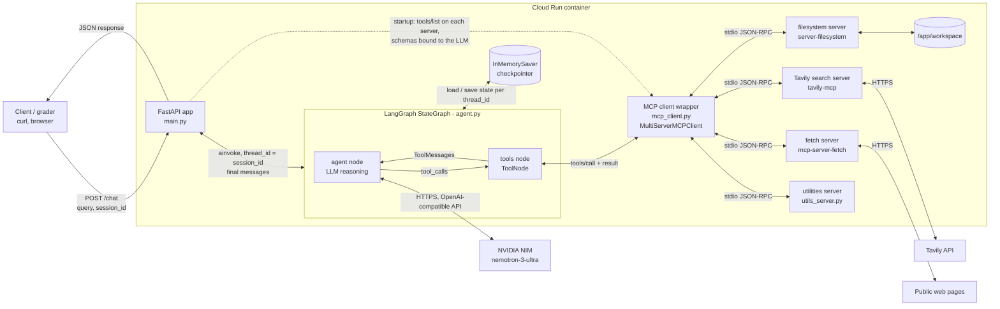
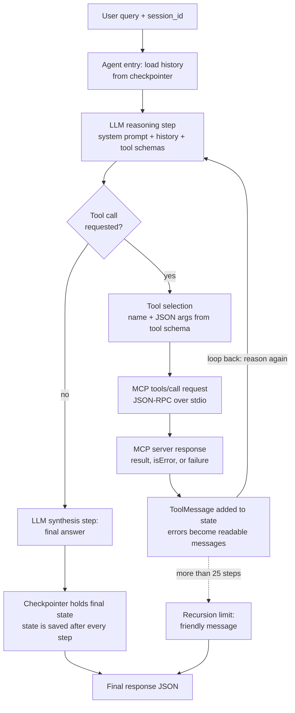
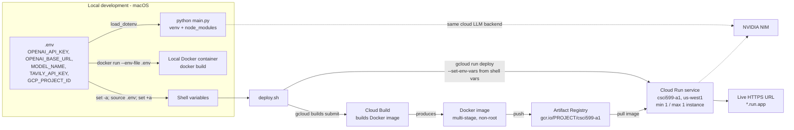

# CSCI 599 Assignment 1: Tool-Using Agent with MCP

A LangGraph agent served by FastAPI on Google Cloud Run. It reasons over each query, decides
whether a tool is needed, calls tools on **four MCP servers** (filesystem, Tavily search,
fetch, and a student-authored utilities server) through real MCP `tools/list` / `tools/call`, and remembers the conversation per
`session_id`.

- **Live URL:** `https://csci599-a1-33512874816.us-west1.run.app`
- **LLM:** NVIDIA NIM `nvidia/nemotron-3-ultra-550b-a55b`, through its OpenAI-compatible API
- **Framework:** LangGraph `StateGraph` + `langchain-mcp-adapters` + FastAPI

## API

```
POST /chat
Request:  { "query": "string", "session_id": "string" }
Response: { "response": "string" }

GET /health   -> { "status": "ok", "mcp_servers": { "<server>": "ok (N tools)" | "unavailable: ..." } }
GET /         -> service name, status and the endpoints above (a landing page for browsers)
GET /docs     -> interactive API page (FastAPI) where POST /chat can be tried in the browser
```

Example:

```bash
curl -X POST "$URL/chat" -H "Content-Type: application/json" \
  -d '{"query": "Search for the latest LangGraph release and save it to notes.txt", "session_id": "demo-1"}'
```

## Project layout

| File | Purpose |
|---|---|
| `main.py` | FastAPI app: `POST /chat`, `GET /health`, error-to-HTTP mapping, reads `PORT` |
| `agent.py` | LangGraph `StateGraph` (agent node, tool node, loop-back edge) + `InMemorySaver` checkpointer |
| `utils_server.py` | Small student-authored MCP server: `calculate` and `current_time` tools |
| `mcp_client.py` | MCP client wrapper: loads `mcp_config.json`, discovers tools per server, formats tool errors |
| `mcp_config.json` | MCP server manifest (secrets come from env vars via `${VAR}` placeholders) |
| `package.json` | Pinned Node MCP servers (filesystem, Tavily) |
| `tests/test_agent.py` | Offline tests with a scripted LLM against the real MCP servers |
| `tests/bad_mcp_server.py` | Deliberately misbehaving stdio MCP server used by the failure-mode test |
| `scripts/smoke_test.sh` | End-to-end scenarios against a running server (local or Cloud Run) |
| `scripts/chat.sh` | Interactive terminal chat with a running server (local or Cloud Run) |
| `Dockerfile`, `deploy.sh` | Container build and Cloud Run deployment |

## MCP servers

| Server | Transport | Tools used for | Source |
|---|---|---|---|
| **filesystem server** | stdio (Node) | read/write/list files inside `WORKSPACE_DIR` only | [`@modelcontextprotocol/server-filesystem`](https://github.com/modelcontextprotocol/servers/tree/main/src/filesystem) |
| **Tavily search server** | stdio (Node) | web search, extract, crawl | [`tavily-mcp`](https://github.com/tavily-ai/tavily-mcp) |
| **fetch server** (additional) | stdio (Python) | download a URL and convert it to markdown | [`mcp-server-fetch`](https://github.com/modelcontextprotocol/servers/tree/main/src/fetch) |
| **utilities server** (additional, student-authored) | stdio (Python, `FastMCP`) | exact arithmetic (`calculate`) and time in any time zone (`current_time`) | [`utils_server.py`](utils_server.py) |

The first three are external open-source projects, used unmodified. The fourth is written for this project.

**Why the third server (fetch):** Tavily is good at *finding* pages, but its results are short
snippets. The fetch server lets the agent *read* a specific page in full, for example a URL the user
pastes or one Tavily returned. That enables multi-step chains like "search, then fetch the top result, then save
a summary to a file". It needs no API key, adds no cost, and uses a different MCP implementation
language (Python) from the other two, which shows the client handles mixed servers.

**Why the fourth server (utilities):** LLMs are unreliable at multi-digit arithmetic and have no clock for
other time zones. `utils_server.py` is a small server written for this project with two tools, each with a
JSON Schema for its input. `calculate` parses the expression into an AST and only allows numbers and
arithmetic operators (no `eval`), and it caps exponents so a request like `9**9**9` cannot hang it.
`current_time` uses the standard `zoneinfo` database. Both return errors as MCP tool errors, which the
agent passes back to the model.

### Verify each server quickly

`GET /health` runs no tools; it reports what `tools/list` discovered at startup. To see each server answer a
real `tools/call`, send these prompts to `POST /chat` (replace `$URL`):

```bash
curl -s $URL/health    # all four servers: "ok (N tools)"

# filesystem server: write then read a file
curl -s -X POST $URL/chat -H "Content-Type: application/json" \
  -d '{"query": "Create hello.txt containing: hi from MCP, then read it back.", "session_id": "verify-1"}'

# utilities server (student-authored)
curl -s -X POST $URL/chat -H "Content-Type: application/json" \
  -d '{"query": "Use your tools to compute (17*23)/4 + 2**10 and tell me the time in Tokyo.", "session_id": "verify-4"}'

# Tavily search server
curl -s -X POST $URL/chat -H "Content-Type: application/json" \
  -d '{"query": "Use web search to find the latest stable Python version.", "session_id": "verify-2"}'

# fetch server: it is chosen whenever the query names a specific URL
curl -s -X POST $URL/chat -H "Content-Type: application/json" \
  -d '{"query": "Use the fetch tool to read https://example.com and quote its text.", "session_id": "verify-3"}'
```

## Architecture diagrams

### 1. System architecture



### 2. Tool invocation flow



At startup, the wrapper calls MCP `tools/list` on each server to discover tool names and JSON
Schemas. Those are bound to the LLM, so it can only produce arguments that match each schema.

### 3. Deployment topology



## Error handling

| Failure mode | What happens | Where |
|---|---|---|
| MCP server unavailable at startup (missing binary, crash, bad config) | That server is logged and skipped; the agent starts with the remaining tools; `/health` shows `unavailable: ...` | `mcp_client.load_mcp_tools` |
| Transport closes during a call (server crashes, binary missing, `Connection closed`) | Exception caught by `ToolNode`, returned to the LLM as an error `ToolMessage` saying the tool "could not be reached"; the LLM tells the user. The next call starts a fresh server process | `mcp_client.tool_error_message` |
| Tool execution error (`isError=true`, e.g. file not found, bad Tavily key) | The adapter returns the server's error text to the LLM as a `ToolMessage` | `langchain-mcp-adapters` (`handle_tool_errors=True`) |
| Malformed or invalid response (result that violates the MCP schema, bad JSON) | Schema violations are reported to the LLM as "returned a malformed or invalid response". Non-JSON on the protocol stream is only visible to the SDK as a closed connection, so it is reported as unreachable | `mcp_client.tool_error_message` |
| Invalid request body | `422` with a JSON `response` message | `main.invalid_request` |
| LLM rate limit / API error | `429` / `502` with a clear JSON message, no stack trace | `main.chat` |
| Endless tool loop | Stopped by `recursion_limit=25` with a friendly message | `main.chat` |

## Memory

The graph is compiled with LangGraph's built-in `InMemorySaver` checkpointer. Each request
passes `{"configurable": {"thread_id": session_id}}`, so:

- the same `session_id` replays the full conversation (questions like "what did I ask you last?" work), and
- a different `session_id` starts with an empty history (sessions are isolated).

Memory lives in the running Cloud Run instance. `--max-instances 1` keeps all sessions on one
instance; history is lost when the instance is recycled, which the assignment allows.

## Setup (local, macOS)

Prerequisites: Python 3.13, Node.js 20+, an NVIDIA NIM key (build.nvidia.com), and a Tavily key (app.tavily.com).

```bash
python3.13 -m venv venv
source venv/bin/activate
pip install -r requirements-dev.txt
npm install                     # installs the Node MCP servers into node_modules/
cp .env.example .env            # then put your real keys in .env
```

## Run locally

```bash
source venv/bin/activate
python main.py                  # serves on http://localhost:8080
# in a second terminal:
bash scripts/smoke_test.sh      # runs the rubric scenarios against localhost
pytest -q                       # offline tests, no API keys needed
```

## Run in Docker locally

```bash
docker build -t csci599-a1 .
docker run --rm -p 8080:8080 --env-file .env csci599-a1
bash scripts/smoke_test.sh
```

## Deploy to Cloud Run

One-time setup: `gcloud auth login`, `gcloud config set project <PROJECT_ID>`, and
`gcloud services enable run.googleapis.com cloudbuild.googleapis.com artifactregistry.googleapis.com`.
Add `GCP_PROJECT_ID` to `.env`, then:

```bash
./deploy.sh
```

`deploy.sh` loads `.env` into shell variables, builds the image with Cloud Build, pushes it to
Artifact Registry (via the `gcr.io` path), and deploys to Cloud Run in `us-west1` with the keys
passed through `--set-env-vars`. No key appears in the repository. The command prints the live URL.
Check it with `bash scripts/smoke_test.sh https://<service-url>`.

**Note on resources:** the service uses `--memory 2Gi` instead of 512Mi, because it runs Python plus
MCP server subprocesses (two Node, two Python) inside one container, and each tool call starts its own
server process. `--concurrency 10` bounds how many of those can run at once. `--min-instances 1` keeps one
instance warm: with scale-to-zero, a burst of requests after idle could be rejected during cold start, and
the in-memory conversation history would be dropped whenever the instance was recycled.

## Cost disclosure

| Item | Cost |
|---|---|
| Cloud Run (`--min-instances 1`, `--max-instances 1`, 1 vCPU, 2 GiB) | **$0 out of pocket.** Usage, Cloud Build and Artifact Registry storage are covered by the $50 USC education credit; nothing is charged to a payment method. |
| NVIDIA NIM (Nemotron 3 Ultra) | **$0.** Free developer tier, rate-limited to about 40 requests per minute. Each agent loop step is one request, so a tool-heavy turn uses 2-5. |
| Tavily search | **$0.** Free tier / student plan credits. |
| Filesystem, fetch and utilities servers | **$0.** Open source (filesystem, fetch) or my own code (utilities), no API key. |

The service must stay deployed until grades are posted. A budget alert is set on the project so credit usage is visible.

## Attribution

- **MCP servers** (external open-source projects, used unmodified): `@modelcontextprotocol/server-filesystem`
  and `mcp-server-fetch` from [modelcontextprotocol/servers](https://github.com/modelcontextprotocol/servers),
  and [`tavily-mcp`](https://github.com/tavily-ai/tavily-mcp) from Tavily.
- **Frameworks:** [LangGraph](https://docs.langchain.com/oss/python/langgraph/overview),
  [`langchain-mcp-adapters`](https://github.com/langchain-ai/langchain-mcp-adapters), FastAPI, and the
  official `mcp` Python SDK.
- **LLM-assisted development:** Claude helped write and debug the code. See `PROCESS_LOG.md`.

## Testing

`pytest -q` runs 11 offline tests, with no API keys needed. A scripted fake LLM drives the real graph against
real MCP servers over stdio. They cover:

- tool discovery on all 4 servers;
- a 2-call tool chain, and answering without tools;
- per-session memory isolation;
- the utilities server computing exactly and rejecting unsafe input;
- tool execution errors (file not found);
- transport and malformed-response errors, including `tests/bad_mcp_server.py`, a real stdio server that
  crashes mid-call, writes garbage to the stream, returns a schema-violating result and returns `isError`,
  after which it still answers a normal call;
- an unavailable server being skipped at startup, an invalid request body returning 422, and the `/` landing page.

`scripts/smoke_test.sh` runs the end-to-end scenarios against a running server (local, Docker or Cloud Run)
with the real LLM. The container image was also built and run locally with Docker and passed the same
smoke test.
